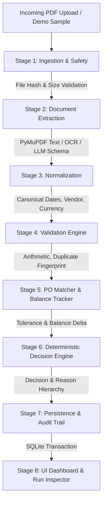

# Architecture & Technical Design
## Zamp AP Invoice Automation: From PDF to Decision

### 1. Overview
The Zamp AP Invoice Automation platform is an enterprise-grade processing system built to ingest vendor invoice PDFs, parse semi-structured tabular and header fields, match them against procurement records, execute deterministic financial validation, and render explainable AP audit decisions (`ELIGIBLE FOR APPROVAL`, `MANUAL REVIEW`, or `ON HOLD`).

The system is designed with strict separation of concerns:
- **AI / Extraction Layer**: LLM structured parsing and heuristic/OCR extraction with schema guarantees. The AI extracts what is in the document and never decides financial disposition.
- **Deterministic Validation & Rules Engine**: Strict Python logic, exact arithmetic using `Decimal`, configurable tolerances, and transparent rule hierarchy.
- **Transactional Persistence**: SQLite with foreign keys, cumulative purchase order balance tracking, and immutable audit logging.
- **Interactive UI**: Streamlit web interface with real-time stage progress, side-by-side PO inspection, filterable history, and pre-packaged demo datasets.

---

### 2. Architecture Diagram



---

### 3. Pipeline Stages Breakdown

#### Stage 1: Ingestion & Safety
- **Validation**: Checks file MIME type (`application/pdf`) and enforces a 10MB file limit.
- **Cryptographic Fingerprint**: Generates SHA-256 hash of the binary stream.
- **Fast Duplicate Check**: Checks if the exact file hash has already been processed in the database.
- **Safe Handling**: Temporary file creation using Python's `tempfile` module with guaranteed cleanup.

#### Stage 2: Document Extraction
- **Text Extraction**: Uses `pymupdf` to extract text blocks, metadata, and page layouts.
- **Scanned Detection**: If extractable characters per page < 50, triggers OCR fallback via `pytesseract` (or provides graceful warning if OCR binary is not present).
- **Structured Extraction**:
  - *LLM Extractor*: When `OPENAI_API_KEY` is present, uses structured JSON mode against Pydantic schema `ExtractedInvoice`.
  - *Deterministic Heuristic Extractor*: Robust regex/token parser that operates completely offline for Demo Mode, extracting vendor names, invoice numbers, dates, line items, tax, and totals with zero external dependencies.
- **Integrity**: Missing fields are marked as `None`, never hallucinated or assumed as zero.

#### Stage 3: Normalization
- **Dates**: Normalized to ISO 8601 `YYYY-MM-DD` via `dateutil`.
- **Currencies**: Mapped to standard ISO 3-letter codes (`USD`, `EUR`, `GBP`, `CAD`).
- **Amounts**: Stored and manipulated as Python `Decimal` objects to prevent floating-point rounding errors.
- **Vendor Identity**: Conservative string normalization (trimming whitespace, case-folding, removing suffixes like "Inc.", "LLC", "Ltd." only for matching lookups while preserving original extracted text).

#### Stage 4: Validation Engine
- **Required Fields**: Ensures `vendor_name`, `invoice_number`, `invoice_date`, and `total_amount` exist.
- **Arithmetic Consistency**: Verifies `subtotal + tax_amount == total_amount` within 1 cent tolerance.
- **Line Item Sum**: When line items exist, verifies `sum(line_item_amounts) == subtotal`.
- **Vendor Status**: Validates vendor against procurement vendor master records (`APPROVED`, `PENDING_REVIEW`, `BLOCKED`, `NOT_FOUND`).
- **Duplicate Detection**: Multi-factor content check combining `vendor_id + invoice_number` and `vendor_id + amount + invoice_date`.

#### Stage 5: Purchase Order Matching & Consumption
- **PO Lookup**: Looks up PO reference extracted from invoice. If no PO reference on invoice, attempts fuzzy/vendor-amount matching.
- **Balance Tracking**: Checks cumulative previously invoiced amounts against the original PO line/header totals.
- **Tolerance Calculation**:
  - Configurable policy: Permitted variance up to $50.00 or 2.0% of the PO value (whichever is lower).
  - Material discrepancy if variance exceeds tolerance or if invoice exceeds the remaining unbilled PO balance.

#### Stage 6: Decision Engine
- Evaluates validation flags and PO matching metrics against deterministic rule hierarchy.
- Outputs one of:
  - `APPROVAL_ELIGIBLE` ("Eligible for Approval")
  - `REVIEW_REQUIRED` ("Manual Review")
  - `ON_HOLD` ("On Hold")
- Generates human-readable, prioritized business reasons and suggested next steps for AP analysts.

#### Stage 7: Persistence & Audit
- Persists into SQLite:
  - `invoices`: Ingestion metadata, status, file hash, extracted JSON.
  - `validations`: Granular validation results (check name, passed/failed, expected, actual, message).
  - `po_consumptions`: Audit of PO balance deduction and cumulative invoice amounts.
  - `audit_events`: Chronological event log with timestamps and user actions.
- ACID transaction guarantees idempotency: retries on failed records do not double-deduct PO balance.

#### Stage 8: Presentation & UI
- Live step-by-step progress rendering.
- Collapsible cards for Extracted Fields, PO Comparison, and Validation Checklist.
- AP Decision Banner with color-coded badges and Action Recommendations.
- Historical Search & Filter Table with Drill-down Audit Trail.

---

### 4. Database Schema

```sql
-- Core Vendors Table
CREATE TABLE vendors (
    vendor_id TEXT PRIMARY KEY,
    name TEXT NOT NULL,
    normalized_name TEXT NOT NULL,
    tax_id TEXT,
    approval_status TEXT NOT NULL CHECK(approval_status IN ('APPROVED', 'PENDING_REVIEW', 'BLOCKED')),
    currency TEXT NOT NULL DEFAULT 'USD',
    created_at TIMESTAMP DEFAULT CURRENT_TIMESTAMP
);

-- Purchase Orders Table
CREATE TABLE purchase_orders (
    po_number TEXT PRIMARY KEY,
    vendor_id TEXT NOT NULL,
    total_amount DECIMAL(12,2) NOT NULL,
    remaining_balance DECIMAL(12,2) NOT NULL,
    currency TEXT NOT NULL DEFAULT 'USD',
    status TEXT NOT NULL CHECK(status IN ('OPEN', 'PARTIALLY_FULFILLED', 'CLOSED', 'CANCELLED')),
    issue_date DATE NOT NULL,
    line_items_json TEXT,
    FOREIGN KEY(vendor_id) REFERENCES vendors(vendor_id)
);

-- Invoices Table
CREATE TABLE invoices (
    id TEXT PRIMARY KEY,
    file_name TEXT NOT NULL,
    file_hash TEXT NOT NULL,
    vendor_id TEXT,
    invoice_number TEXT,
    invoice_date DATE,
    currency TEXT,
    subtotal DECIMAL(12,2),
    tax_amount DECIMAL(12,2),
    total_amount DECIMAL(12,2),
    po_number TEXT,
    status TEXT NOT NULL CHECK(status IN ('APPROVAL_ELIGIBLE', 'REVIEW_REQUIRED', 'ON_HOLD', 'FAILED')),
    primary_reason TEXT,
    all_reasons_json TEXT,
    extracted_data_json TEXT,
    created_at TIMESTAMP DEFAULT CURRENT_TIMESTAMP,
    updated_at TIMESTAMP DEFAULT CURRENT_TIMESTAMP
);

-- PO Consumption Audit Table
CREATE TABLE po_consumptions (
    id TEXT PRIMARY KEY,
    po_number TEXT NOT NULL,
    invoice_id TEXT NOT NULL UNIQUE,
    invoiced_amount DECIMAL(12,2) NOT NULL,
    previous_balance DECIMAL(12,2) NOT NULL,
    new_balance DECIMAL(12,2) NOT NULL,
    consumed_at TIMESTAMP DEFAULT CURRENT_TIMESTAMP,
    FOREIGN KEY(po_number) REFERENCES purchase_orders(po_number),
    FOREIGN KEY(invoice_id) REFERENCES invoices(id)
);

-- Granular Validation Checks Table
CREATE TABLE validation_results (
    id TEXT PRIMARY KEY,
    invoice_id TEXT NOT NULL,
    rule_name TEXT NOT NULL,
    status TEXT NOT NULL CHECK(status IN ('PASS', 'WARN', 'FAIL')),
    expected_value TEXT,
    actual_value TEXT,
    message TEXT NOT NULL,
    FOREIGN KEY(invoice_id) REFERENCES invoices(id)
);

-- Audit Log Table
CREATE TABLE audit_logs (
    id TEXT PRIMARY KEY,
    invoice_id TEXT,
    event_type TEXT NOT NULL,
    description TEXT NOT NULL,
    metadata_json TEXT,
    created_at TIMESTAMP DEFAULT CURRENT_TIMESTAMP
);
```
